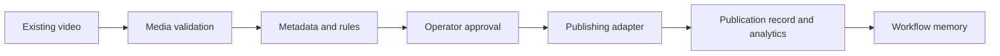

# AI Content OS

**Focus:** workflow architecture, publishing automation and human approval.

A platform for moving an existing video file through technical validation, metadata generation, operator review, publishing, analytics and accumulated workflow memory.

The documented local path registers the file, reads real media properties with ffprobe, validates metadata against schemas and brand rules, waits for human acceptance and creates a publication record through a local adapter. PostgreSQL stores state; Redis carries jobs.

**Architecture:** separate entry-point applications and reusable packages for domain rules, model gateway, agents, integrations, media, observability, knowledge and memory. Knowledge, execution memory and operational state have distinct responsibilities.

**Stack:** pnpm/TypeScript monorepo, PostgreSQL, Redis, Docker and n8n integration scaffolding.

**Evidence:** local README, architecture documents and development guides inspected for this case study. Source is not published in this portfolio.

**Boundary:** the MVP publishes already-produced content. Research, scripting, editing and generated-video production are outside its current MVP scope. The local adapter demonstrates the workflow without proving every live social-platform integration.

